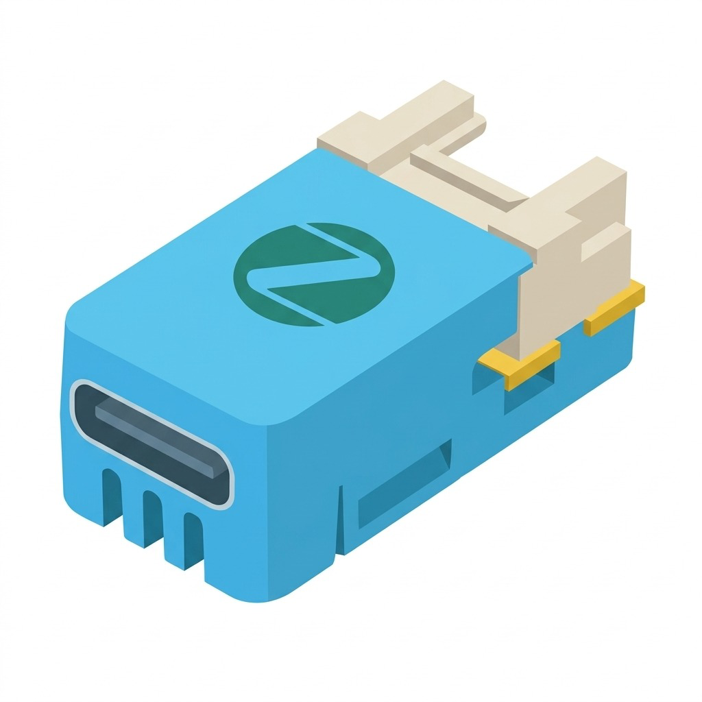

# M5Stack M5NanoC6 Philips Hue Zigbee Extender (Fake Lamp Router)

[](https://opensource.org/licenses/MIT)
[](https://docs.m5stack.com/en/core/M5NanoC6)
[-blue.svg)](https://www.espressif.com/en/products/socs/esp32-c6)
[](https://csa-iot.org/all-solutions/zigbee/)
[](https://www.philips-hue.com/)
[](https://github.com/espressif/arduino-esp32)
[](./firmware/)

<p align="center">
  
</p>

<p align="center">
  <b>Language / Idioma:</b><br>
  <a href="#english">English</a> | <a href="#portugues">Português</a> | <a href="#espanol">Español</a>
</p>

---

<a id="english"></a>
## 🇬🇧 English

Open-source firmware converting the ultra-compact **M5Stack M5NanoC6** (ESP32-C6FH4) development board into a **Philips Hue Range Extender (Router)**.

Because the Philips Hue Bridge does not officially support generic Zigbee range extenders, this project emulates an **RGB + CCT Color Dimmable Light** (`GLEDOPTO GL-C-008P`) operating in **Zigbee Router (ZCZR)** mode. It seamlessly joins your Philips Hue Bridge network, acts as a full Zigbee signal repeater across your house, and provides physical hardware actuation!

### ✨ Features
- 🌐 **True Zigbee 3.0 Router (Range Extender):** Routes mesh traffic at the IEEE 802.15.4 layer and supports up to 20 child end devices in the Hue network.
- 💡 **Native Philips Hue Bridge Pairing:** Embeds the required Hue / ZLL Trust Center Key (`81:42:86:86:5D:C1:C8:B2:C8:CB:C5:2E:5D:65:D1:B8`) and `app_device_version = 1`, ensuring seamless discovery by Hue Bridge.
- 🎨 **Full RGB + CCT Color Support:** Full color wheel control (CIE 1931 XY gamut with automatic wide-gamut normalizer) and color temperature slider (6500K Cool White to 2000K Warm Candle) directly on the onboard WS2812 LED.
- 🔌 **Grove Actuator (GPIO 1 & GPIO 2):** When turned ON in the Hue app, Grove signal pins (GPIO 1 and GPIO 2) are driven to `HIGH` (3.3V) to trigger external relays, MOSFETs, or actuators. When turned OFF, they return to `LOW` (0V). Note: Pin 3 (+5V) of Grove Port A is continuously powered from USB VBUS.
- 🔘 **Front Button (GPIO 9):**
  - **Quick Click (< 1s):** Toggles the lamp state locally (ON/OFF) and reports back to the Philips Hue Bridge.
  - **Long Press (5s):** Clears Zigbee NVRAM/NVS credentials, unpairs from the current network, and reboots in pairing mode.
- 🚦 **LED Status Machine:**
  - **Pairing / Searching:** Blinking blue every 1s (500ms ON / 500ms OFF).
  - **Connected:** Solid blue for 2s, transitions to solid green for 3s, then enters normal operation.
  - **Normal Operation:** Matches selected Hue color, temperature, and brightness.

### 📌 Hardware Pinout (M5NanoC6)
| Pin | Function | Configuration | Description |
| :--- | :--- | :--- | :--- |
| **GPIO 9** | Front Button | `INPUT_PULLUP` | Active-low input (Quick Click = Toggle, 5s = Factory Reset) |
| **GPIO 7** | Blue Status LED | `OUTPUT` | Network connection / pairing indicator |
| **GPIO 19** | RGB LED Power Switch | `OUTPUT` | WS2812 power switch (`HIGH` = enabled, `LOW` = disabled) |
| **GPIO 20** | RGB LED Data | `rgbLedWriteOrdered()` | WS2812 addressable RGB LED (GRB order) |
| **GPIO 1** | Grove Pin 1 (White / SCL) | `OUTPUT` | Driven `HIGH` (3.3V) on Light ON, `LOW` (0V) on Light OFF |
| **GPIO 2** | Grove Pin 2 (Yellow / SDA) | `OUTPUT` | Driven `HIGH` (3.3V) on Light ON, `LOW` (0V) on Light OFF |
| **Grove 5V** | Power Rail (Red) | Power Output | Directly tied to USB Type-C 5V rail (PPTC fuse protected) |
| **USB CDC** | Serial Monitor & Upload | 115200 bps | Native USB-Serial/JTAG port |

### 🏠 Pairing with Philips Hue Bridge
1. Power on the M5NanoC6 via USB-C. The status LED will begin blinking blue (searching for network).
2. Open the **Philips Hue App** on your smartphone.
3. Navigate to **Settings ➔ Lights ➔ Add light** (or the **+** button).
4. Tap **Search** (or enter the 6-character Serial Number shown in the serial monitor).
5. The Hue Bridge will discover the device as an extended color light.
6. The M5NanoC6 will confirm connection with solid blue (2s), then solid green (3s), and then mirror your Hue app's color and light state!
7. Assign it to any room or zone to extend Zigbee coverage.

### 🔥 Pre-compiled Binaries (v1.0.0)
Located in [`firmware/`](./firmware/):
| File | Offset / Address | Description |
| :--- | :--- | :--- |
| **`m5nanoc6_hue_extender_v1.0.0_merged.bin`** | `0x0000` | **Recommended:** Complete all-in-one flash image (Bootloader + Partitions + App). |
| **`m5nanoc6_hue_extender_v1.0.0.bin`** | `0x10000` | Application firmware binary. |
| **`bootloader.bin`** | `0x0000` | ESP32-C6 second-stage bootloader. |
| **`partitions.bin`** | `0x8000` | Zigbee ZCZR 4MB partition table. |

#### Flashing with M5Burner:
1. Open **M5Burner**.
2. Select **NanoC6** and choose **Custom Burn**.
3. Select `firmware/m5nanoc6_hue_extender_v1.0.0_merged.bin` at address `0x0000`.
4. Click **Burn**!

### 🛠️ Building with arduino-cli
```bash
# Compile
arduino-cli compile -b esp32:esp32:m5stack_nanoc6:ZigbeeMode=zczr,PartitionScheme=zigbee_zczr,CDCOnBoot=cdc .

# Upload
arduino-cli upload -p <SERIAL_PORT> -b esp32:esp32:m5stack_nanoc6:ZigbeeMode=zczr,PartitionScheme=zigbee_zczr,CDCOnBoot=cdc .

# Monitor
arduino-cli monitor -p <SERIAL_PORT> -c baudrate=115200
```

---

<a id="portugues"></a>
## 🇧🇷 Português

Firmware de código aberto para transformar o microcontrolador **M5Stack M5NanoC6** (ESP32-C6FH4) em um **Extensor de Alcance (Router) Zigbee para Philips Hue**.

Como o Philips Hue Bridge não permite parear extensores genéricos diretamente, este projeto emula uma **Lâmpada Colorida RGB + CCT Dimerizável** (`GLEDOPTO GL-C-008P`) operando em modo **Zigbee Router (ZCZR)**. Ele se conecta perfeitamente ao Hue Bridge, repete os sinais Zigbee de outros dispositivos e aciona saídas físicas na placa!

### ✨ Funcionalidades
- 🌐 **Roteador Zigbee 3.0 Real:** Roteia tráfego de malha na camada 802.15.4 e suporta até 20 dispositivos filhos na rede Hue.
- 💡 **Pareamento Nativo com Philips Hue:** Incorpora a chave de transporte Trust Center ZLL (`81:42:86:86:5D:C1:C8:B2:C8:CB:C5:2E:5D:65:D1:B8`) e versão `app_device_version = 1`.
- 🎨 **Cores RGB e Temperatura de Cor (CCT):** Suporte total ao seletor de cores da Hue (decodificador CIE 1931 XY de ampla gama sem distorções) e controle de temperatura de branco (de 6500K branco frio a 2000K branco quente).
- 🔌 **Acionamento Grove (GPIO 1 e GPIO 2):** Ao ligar a lâmpada, os pinos de sinal do Grove vão para nível alto (`HIGH` - 3.3V), permitindo controlar relés, optoacopladores ou módulos externos. Ao desligar, vão para `LOW` (0V). *Nota: O pino de 5V do conector Grove é alimentado diretamente pela USB.*
- 🔘 **Botão Frontal (GPIO 9):**
  - **Clique Rápido (< 1s):** Alterna o estado da lâmpada (ON/OFF) e notifica o Hue Bridge em tempo real.
  - **Pressão Longa (5s):** Limpa a NVRAM/NVS do Zigbee, desconecta da rede e reinicia em modo de pareamento.
- 🚦 **Sinalização dos LEDs:**
  - **Buscando rede / Pareamento:** LED azul piscando a cada 1s.
  - **Conectado:** Azul fixo por 2s, verde por 3s e entra em operação.
  - **Operação Normal:** Reproduz exatamente a cor, brilho e temperatura selecionados no app Hue.

### 📌 Mapeamento de Pinos (M5NanoC6)
| Pino | Função | Configuração | Descrição |
| :--- | :--- | :--- | :--- |
| **GPIO 9** | Botão Frontal | `INPUT_PULLUP` | Entrada ativa em nível baixo (Clique = Comutar, 5s = Reset) |
| **GPIO 7** | LED Azul de Status | `OUTPUT` | Indicador de conexão e pareamento |
| **GPIO 19** | Chave Força LED RGB | `OUTPUT` | Chave de alimentação do WS2812 (`HIGH` = ligado) |
| **GPIO 20** | Dados LED RGB | `rgbLedWriteOrdered()` | Linha de dados do LED endereçável WS2812 (ordem GRB) |
| **GPIO 1** | Grove Pino 1 (Branco / SCL) | `OUTPUT` | `HIGH` (3.3V) quando LIGADO, `LOW` (0V) quando DESLIGADO |
| **GPIO 2** | Grove Pino 2 (Amarelo / SDA) | `OUTPUT` | `HIGH` (3.3V) quando LIGADO, `LOW` (0V) quando DESLIGADO |
| **Grove 5V** | Barramento 5V (Vermelho) | Alimentação | Conectado diretamente ao VBUS da USB (protegido por PPTC) |
| **USB CDC** | Monitor Serial e Gravação | 115200 bps | Porta nativa USB-Serial/JTAG |

### 🏠 Pareando com o Philips Hue Bridge
1. Ligue o M5NanoC6 via cabo USB-C. O LED azul começará a piscar (modo busca).
2. Abra o aplicativo **Philips Hue** no celular.
3. Acesse **Configurações ➔ Luzes ➔ Adicionar luz** (ou toque no ícone **+**).
4. Toque em **Pesquisar**.
5. O Hue Bridge encontrará o dispositivo como uma lâmpada colorida dimerizável.
6. O M5NanoC6 confirmará com azul fixo (2s) e verde (3s). Pronto! Ele já está roteando e expandindo sua rede Zigbee.

---

<a id="espanol"></a>
## 🇪🇸 Español

Firmware de código abierto que convierte la placa **M5Stack M5NanoC6** (ESP32-C6FH4) en un **Extensor de Alcance (Router) Zigbee para Philips Hue**.

Emula una **Bombilla de Color RGB + CCT Regulable** (`GLEDOPTO GL-C-008P`) operando en modo **Zigbee Router (ZCZR)** para unirse de forma nativa al Philips Hue Bridge, repitiendo señales en la red de malla y accionando puertos físicos en la placa.

### ✨ Características
- 🌐 **Router Zigbee 3.0 Real:** Enruta el tráfico en la capa 802.15.4 y admite hasta 20 dispositivos hijos en la red Hue.
- 💡 **Emparejamiento Nativo Philips Hue:** Incluye la clave Trust Center ZLL (`81:42:86:86:5D:C1:C8:B2:C8:CB:C5:2E:5D:65:D1:B8`) y `app_device_version = 1`.
- 🎨 **Soporte Completo RGB + CCT:** Control total de color (espectro CIE 1931 XY) y temperatura de blancos (6500K a 2000K) en el LED WS2812.
- 🔌 **Accionamiento Grove (GPIO 1 y GPIO 2):** Nivel alto (`HIGH` - 3.3V) cuando la luz está encendida, y `LOW` (0V) quando está apagada.
- 🔘 **Botón Multifunción (GPIO 9):** Clic rápido (< 1s) para encender/apagar localmente; 5s para restablecimiento de fábrica.

---

## 📄 License
This project is licensed under the [MIT License](LICENSE).
